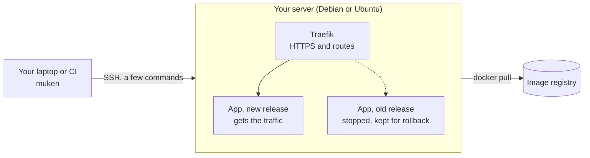

# muken (無間)

Put your Docker app on a server you own, with no gap between releases.

muken is one program. You describe your app in a short file. muken prepares the server (Docker and a proxy), starts the new version next to the old one, moves visitors over when the new one is healthy, and goes back by itself when it is not.

It was made for the [shinsenter/php](https://github.com/shinsenter/php) images, and it works with any app that runs in Docker and answers an HTTP health check. muken does not build your image: you build and push it, and the server pulls it.

> [!WARNING]
> Version 0.1, in development. The code has unit tests that run without a server, and it was run by hand on one real DigitalOcean server. Certificates, the Hetzner, Vultr, AWS and Cloudflare APIs and several other parts were not tested on a real setup, so try it on a test machine first. The guide lists what is tested and what is not.

Guide: [docs/guide.md](docs/guide.md). Site: https://shinsenter.github.io/muken/. For maintainers: [docs/development.md](docs/development.md).

## Quick start

```shell
muken init      # answer a few questions. It writes muken.yaml
muken doctor    # check the config, the SSH login and DNS
muken up        # prepare the server, set DNS and deploy
muken deploy    # every later release
```

The guide has the details, including how to get a server: [Quick start](docs/guide.md#quick-start).

## The idea

Deploying a small app should not need a platform, a cluster or a page of scripts. It needs a few things done in the right order, and the same way every time:

1. A server that is ready (Docker, firewall, a proxy with HTTPS).
2. The new version starts next to the old one.
3. Visitors move only when the new version says it is healthy.
4. If anything fails on the way, nothing changes for visitors.
5. Going back is one command.

muken does these things and nothing else. It does not run on your server all the time: it connects over SSH, does the work, and leaves. What it leaves behind is plain Docker and a proxy, so you can stop using muken and keep the server.

## How it works



- One binary on your machine, with SSH built in. You do not need Docker, Ansible or Python locally. A few commands (`ssh`, `exec`, `logs -f`, `agent open`) call the `ssh` program of your machine.
- On the server, only Debian or Ubuntu with SSH. muken prepares the rest.
- The proxy is Traefik. muken writes one small route file per app, and swapping that file moves the traffic.
- The old version stays stopped on the server, so `rollback` has nothing to pull or build.

## What you get

- `init` asks a few questions and writes the config. No YAML to write from scratch.
- `up` prepares the server, sets DNS and deploys. `deploy` ships a new version, `rollback` goes back, `deploy --plan` shows what would change.
- Health-checked switch with no gap, and an automatic return when a check fails.
- A maintenance page (`maintenance on`) that can be your own HTML file, and a choice to keep it through a deploy or a rollback.
- Migrations that run before the switch, workers (queues, schedulers), and a database or Redis on the same server.
- Secrets that stay encrypted in your repository.
- Servers at DigitalOcean, Hetzner, Vultr and AWS, DNS and certificates through Cloudflare.
- A small monitoring sidecar: a status page, metrics for Prometheus and alerts to Slack or Discord.
- Kubernetes manifests from the same config, if you outgrow one server.
- Presets for every image and app of the shinsenter/php project (WordPress, Laravel, Symfony, Drupal, Nextcloud and more).

## Install

- The binary: download the file for your system from the [Releases page](https://github.com/shinsenter/muken/releases), check its checksum and put it on your `PATH`.
- The Docker image, if you would rather not install anything: `docker run --rm ghcr.io/shinsenter/muken help`.

Release files are signed, and each release is scanned for known vulnerabilities before it is published. The guide shows how to check the signature: [Install](docs/guide.md#install).

## What it does not do

One server per app, no load balancer over several servers, no database backups, no migration rollback. Servers must run Debian or Ubuntu. These limits are on purpose: the tool stays small enough to read in an afternoon.

A deploy has no gap, but a few commands can interrupt the app. The guide lists them in [When an interruption is possible](docs/guide.md#when-an-interruption-is-possible).

## About the name

無間 reads "muken" in this project and means "no gap" or "no interval". That is the goal: no gap between the old release and the new one. The name is borrowed from the manga Bleach.

## Support the project

muken is free and stays free. Keeping it working takes steady effort: new Docker releases, changes in the cloud APIs, and the questions that come with real servers. If it saves you time, or it runs something that earns money for you, a donation helps me keep it maintained. It is a thank-you, never a requirement.

- [Donate via PayPal](https://www.paypal.me/shinsenter)
- [Sponsor on GitHub](https://github.com/sponsors/shinsenter)

If money is not the way for you, a star, a bug report, a fix or a word to a colleague also helps.

## License and credit

muken is released under the [Apache License 2.0](LICENSE). You can use it, change it and build products and services on it, including paid ones. Keep the copyright notice in [NOTICE](NOTICE) when you pass it on. The name "muken" is not part of the license: see [TRADEMARK.md](TRADEMARK.md) for what you can do with it.

Run `muken version --license` to read the license and the name policy that are built into the binary.

Copyright 2026 Mai Nhut Tan. To contribute, read [CONTRIBUTING.md](CONTRIBUTING.md) first: it has a short agreement about the license of your contribution.
