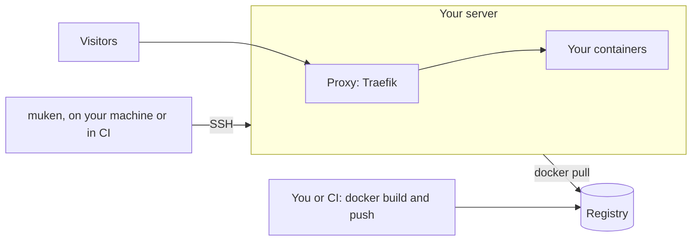
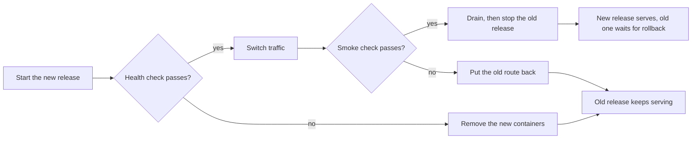

<!--
################################################################################
#     These setups are part of the project: https://code.shin.company/php
#     Please respect the intellectual effort that went into creating them.
#     If you use or copy these ideas, proper credit would be appreciated.
#      - Author:  Mai Nhut Tan <shin@shin.company>
#      - License: https://code.shin.company/php/blob/main/LICENSE
################################################################################
-->

# muken (無間)

`muken` puts a Docker image on a server that you own, with no gap between the old version and the new one. You give it an image and a domain.

muken prepares the server, starts the new version next to the old one, moves traffic when the new version passes a health check, and goes back by itself when a check fails.

It was made for the images of [shinsenter/php](https://github.com/shinsenter/php) and works with any app that answers an HTTP health check.

- [Before you start](#before-you-start)
- [Install](#install)
- [Quick start](#quick-start)
- [What a deploy does](#what-a-deploy-does)
- [When an interruption is possible](#when-an-interruption-is-possible)
- [Commands](#commands)
- [muken.yaml](#mukenyaml)
- [Common cases](#common-cases)
- [Monitoring](#monitoring)
- [Cloudflare](#cloudflare)
- [Kubernetes](#kubernetes)
- [What is tested and what is not](#what-is-tested-and-what-is-not)
- [Verbose output](#verbose-output)
- [Troubleshooting](#troubleshooting)
- [About the name](#about-the-name)


## Before you start

| You need | Details |
|---|---|
| A server | Debian or Ubuntu, reachable over SSH as `root` or as a user with passwordless sudo. Ports 80 and 443 open. muken can create one at DigitalOcean, Hetzner or Vultr |
| A domain | An A record that points to the server. With Cloudflare, muken sets it for you |
| An image | Your app, built `FROM` a shinsenter image and pushed to a registry that the server can pull from. **muken never builds images** |
| Your machine | The `muken` binary, or the muken Docker image. You do not need Docker, Ansible or Python locally |

How the parts work together:



muken connects over SSH, runs `docker` on the server (pull, start, stop) and writes one small route file for the proxy. It does not stay on the server.

Words used in this guide:

| Word | Meaning |
|---|---|
| Release | One deploy: the containers started from one image at one time. Its name is the time, for example `20261116T100000` |
| Web container | A container that runs your image and serves HTTP |
| Worker | The same image with another command, for example a queue or a scheduler |
| Accessory | A database or Redis that muken starts once and keeps across deploys |
| Proxy | Traefik. One per server. It owns ports 80 and 443 and sends each domain to its app |
| Health check | muken waits until the health URL of the image answers, before it sends traffic |
| Smoke check | An optional URL (`web.smoke_path`) that muken requests through the proxy right after the switch |
| Drain | A short wait after the switch, so running requests can finish on the old release |
| Rollback | Going back to the previous release. muken keeps it stopped for this |


## Install

### The binary

Download a binary from the [Releases page](https://github.com/shinsenter/muken/releases) (tags look like `v0.1.0`), check it and put it on your `PATH`:

```shell
gh release download v0.1.0 --repo shinsenter/muken \
    --pattern 'muken-darwin-arm64*' --pattern checksums.txt     # pick the file for your machine
shasum -a 256 -c checksums.txt --ignore-missing
install -m 755 muken-darwin-arm64 /usr/local/bin/muken
muken version
```

> [!NOTE]
> On macOS the file is not notarized, so remove the quarantine flag once: `xattr -d com.apple.quarantine /usr/local/bin/muken`.

muken is one static file with SSH built in.

### The Docker image

Use the image if you would rather not install anything. It has muken and an SSH client, for amd64 and arm64. It has no Docker CLI, because muken runs every docker command on the server over SSH.

| Tag | Base | Use it for |
|---|---|---|
| `0.1.0`, `0.1`, `latest` | the official `alpine` image, newest at build time | muken only. Starts at once. No Docker CLI |

```shell
docker run --rm -it \
    -v "$PWD":/work \
    -v ~/.ssh:/root/.ssh \
    -e CLOUDFLARE_API_TOKEN \
    ghcr.io/shinsenter/muken deploy
```

The image has `muken` as its entry point, so what you write after the image name is the muken command.

In each `-v A:B`, `A` is a path on your machine and `B` is where it appears inside the container. What the example gives the container:

| Option | From your machine | Needed when |
|---|---|---|
| `-v "$PWD":/work` | Your project folder, with `muken.yaml` | Always |
| `-v ~/.ssh:/root/.ssh` | Your SSH keys and `known_hosts` | muken connects to a server |
| `-e CLOUDFLARE_API_TOKEN` | The variable from your shell | `cloudflare.enabled: true` |

Other things you may want:

| You want | Do this |
|---|---|
| Files from `muken init` that belong to you | Add `--user "$(id -u):$(id -g)"`. Mount `~/.ssh` to that user's home and set `-e HOME=...` |
| `muken logs -f`, `exec` or `ssh` | Run with `-it`. They use the `ssh` of the image |
| `muken secrets` | The key is `.muken/age.key` in your project folder, so `-v "$PWD":/work` already carries it. Or pass `-e MUKEN_AGE_KEY` (the key text) or `-e MUKEN_AGE_KEY_FILE` (a file you mount) |

#### SSH from a container

muken reads the key from `/root/.ssh` in the container, the same as on your machine: `server.ssh_key` first, then `id_ed25519`, `id_ecdsa`, `id_rsa`.

| Topic | What to do |
|---|---|
| Mounting `~/.ssh` | Mount the folder without `:ro`. muken writes the key of a new server to `known_hosts`, and a read-only mount fails with `read-only file system` |
| Mounting `known_hosts` alone | Works for muken. The `ssh` command warns `Cross-device link` |
| First connection to a server | muken asks you to confirm the fingerprint, so use `-it`. In CI there is no terminal: add `--accept-new`, or put the server line in `known_hosts` before the run |
| A key with a passphrase | It must come from ssh-agent. Pass the socket in (see below). You still mount `known_hosts` |
| Keys in the image | Never. Mount the key, or in CI write it from a secret at run time |

Pass the ssh-agent socket like this:

| Host | Flags |
|---|---|
| Linux | `-v "$SSH_AUTH_SOCK":/ssh-agent -e SSH_AUTH_SOCK=/ssh-agent` |
| Docker Desktop for Mac | `-v /run/host-services/ssh-auth.sock:/ssh-agent -e SSH_AUTH_SOCK=/ssh-agent` |

#### A key for this project only

Mounting `~/.ssh` gives the container every key you own. If you want the container to see one key and nothing else, create a key for the project:

```shell
muken server key                                  # writes .muken/.ssh/id_ed25519 and .pub next to muken.yaml
muken server create --ssh-pubkey .muken/.ssh/id_ed25519.pub
```

Then set `ssh_key: .muken/.ssh/id_ed25519` under `server:` and mount only that folder:

```shell
docker run --rm -it \
    -v "$PWD":/work \
    -v "$PWD/.muken/.ssh":/root/.ssh \
    ghcr.io/shinsenter/muken deploy
```

Good to know:

- `known_hosts` is saved in the same folder, so the container remembers the server.
- For another key, for example one per customer, run `muken server key acme` and point `ssh_key` at it.
- The key has no passphrase.
- muken writes a `.gitignore` in `.muken`, so the key is not committed.

> [!WARNING]
> Add `.muken` to `.dockerignore` too. Otherwise `COPY . .` in your app's Dockerfile puts the private key into your image.

#### In CI

To build an image and deploy it in one job, run `docker build` on the CI runner first, then run the muken image. The runner needs Docker. The muken image does not.

Example for GitHub Actions, with the key in the secret `DEPLOY_KEY` and one `known_hosts` line (copy it from your own `~/.ssh/known_hosts`) in the secret `DEPLOY_KNOWN_HOSTS`:

```shell
mkdir -m 700 ssh
printf '%s\n' "$DEPLOY_KEY" > ssh/id_ed25519 && chmod 600 ssh/id_ed25519
printf '%s\n' "$DEPLOY_KNOWN_HOSTS" > ssh/known_hosts
docker run --rm -v "$PWD":/work -v "$PWD/ssh":/root/.ssh ghcr.io/shinsenter/muken deploy
```

### Check the download

Every release file has a keyless signature (`<file>.sigstore.json`) that names the workflow and tag that built it:

```shell
cosign verify-blob --bundle muken-darwin-arm64.sigstore.json \
    --certificate-identity "https://github.com/shinsenter/muken/.github/workflows/release.yml@refs/tags/v0.1.0" \
    --certificate-oidc-issuer https://token.actions.githubusercontent.com muken-darwin-arm64
```

Releases come from the `muken` workflow, which tests the tool and scans it for known vulnerabilities (`govulncheck` and Trivy) before it publishes. It scans again every Monday.

The Docker image is scanned for fixable HIGH and CRITICAL vulnerabilities before it is pushed, and signed with cosign:

```shell
cosign verify ghcr.io/shinsenter/muken:0.1.0 \
    --certificate-identity-regexp 'https://github.com/shinsenter/muken/.github/workflows/image.yml@refs/tags/v.*' \
    --certificate-oidc-issuer https://token.actions.githubusercontent.com
```

### Build from source

You need Go 1.26 or newer. `make dist` writes `muken-{linux,darwin}-{amd64,arm64}` to `dist/`.

## Quick start

### 1. Describe your app

Run this in your project folder:

```shell
muken init
```

muken asks:

- what you want to run (it guesses from `composer.json`)
- the domain, and an email for certificates
- which PHP version (the list includes the release candidate `8.6` for testing)
- which database, or none
- whether you want Redis or background workers

Answer with the arrow keys and Enter. It writes `muken.yaml`. Nothing else changes.

> [!TIP]
> `muken init` asks for the Docker image. Press Enter to take the stock shinsenter image and try muken first. For your own app, build an image `FROM` a shinsenter image, push it to a registry, and give its name. muken only pulls it on the server.

You can skip the questions:

```shell
muken init --preset laravel --domain shop.example.com --email me@example.com \
    --host YOUR_SERVER_IP --db postgres,redis --workers queue,scheduler
```

> [!IMPORTANT]
> `YOUR_SERVER_IP`, `shop.example.com` and `me@example.com` are placeholders. Replace each one with your own value before you run a command from this guide. `example.com` is a name reserved for documentation, so it never belongs to anyone.

`muken init --list` lists everything it knows: the plain PHP images (`php-nginx`, `php-apache`, `php-roadrunner`, `php-frankenphp`) and the apps in `src/webapps/` (WordPress, Laravel, Symfony, Drupal, Nextcloud and more).

### 2. Get a server

If you have a server, put its IP in `server.host` and make sure `ssh root@<ip>` works.

If not, muken can create one:

```shell
export DIGITALOCEAN_TOKEN=...        # or HCLOUD_TOKEN for Hetzner, VULTR_API_KEY for Vultr
muken server create
```

A DigitalOcean token with custom scopes needs:

| Scope | Permissions |
|---|---|
| droplet | create, read, delete |
| ssh_key | create, read |
| tag | create |
| regions | read |
| sizes | read |

If one is missing, the error names it, for example `You are missing the required permission tag:create`. A full-access token also works.

> [!TIP]
> Give the token a short expiry and delete it when you are done.

`muken server create`:

1. Shows regions and plans as a numbered list.
2. Asks you to confirm.
3. Installs your SSH key: the first of `~/.ssh/id_ed25519.pub`, `id_ecdsa.pub`, `id_rsa.pub`, or the file you pass with `--ssh-pubkey`. `muken server key` makes a key just for this project.
4. Waits until SSH answers.
5. Saves `server.host`.

> [!WARNING]
> A server costs money until you delete it with `muken server delete`.

### 3. Point the domain to the server

Add an A record for your domain with the server IP. With Cloudflare, muken does this for you (see [Cloudflare](#cloudflare)).

### 4. Check and deploy

```shell
muken doctor     # checks config, SSH and DNS. Docker and the proxy come with `muken up`
muken up         # prepares the server, then deploys
```

`up` sets up the server (Docker, firewall, proxy, swap, automatic security updates), sets DNS and then runs `deploy`. It is safe to run again. The site is on `https://<your domain>` when it ends.

> [!NOTE]
> Before the first `up`, `doctor` only warns when Docker or the proxy is missing and when the domain does not resolve yet. `muken up` fixes the first two. A real error is a failed SSH login, an invalid `muken.yaml`, a secrets file that cannot be decrypted, or a proxy that stopped on a server that `up` already set up.

From now on, ship a new version with:

```shell
muken deploy
```

### `up` or `deploy`?

| Command | What it does | Use it |
|---|---|---|
| `muken up` | Prepares the server, sets DNS, then deploys | The first time on a server |
| `muken deploy` | Only deploys | Every later release |

> [!NOTE]
> A second `up` on a prepared server skips the base setup (packages, Docker, firewall, swap) and says so. It still updates the proxy, so a change to `email` or `tls` takes effect.


## What a deploy does



1. Take a lock, so two deploys cannot run at the same time.
2. Pull the image on the server.
3. Run the migration command in a throwaway container. If it fails, nothing starts.
4. Start the new web containers and wait for the health URL of the image (`/readyz` on port 2020, see [scaling.md](https://github.com/shinsenter/php/blob/main/.claude/docs/scaling.md)).
5. Start the new workers and check they stay up.
6. Switch the proxy to the new containers. The proxy reloads its route file without dropping connections.
7. Optional smoke check (`web.smoke_path`). If it fails, the old route comes back.
8. Wait `web.drain`, then stop the old release with `web.stop_grace` to finish running requests.
9. Keep the old release stopped for `muken rollback`. Remove older ones.

Any failure before step 6 leaves the old release running.

> [!IMPORTANT]
> Migrations run while the old code still serves, so write them to work with both versions: add columns before you use them, and remove them one release later.


## When an interruption is possible

A deploy has no gap. Some other commands and some servers can interrupt the app, or other things that run on the same server. muken prints a warning before it restarts Docker or the proxy.

| Command | What can be interrupted | How to avoid it |
|---|---|---|
| First `muken up` on a server that already runs Docker and has no `/etc/docker/daemon.json` | Docker restarts to apply the log settings. Every container on the server stops, and those without a restart policy stay stopped | Create `/etc/docker/daemon.json` first, for example `{"log-driver":"json-file","log-opts":{"max-size":"10m","max-file":"3"}}`. muken then does not restart Docker. Or use a new server |
| First `muken up` on a server that runs other services | muken turns on the `ufw` firewall and opens only SSH (`server.port`), 80 and 443. If the firewall was off, every other incoming port is blocked | Run `ufw allow <port>` for your other services first, or use a server only for muken |
| `muken up` after a change of `email`, `tls`, `server.traefik_image` or the Cloudflare token | The proxy restarts. Every app on the server drops open connections for a few seconds | Change them when traffic is low |
| `muken maintenance on` | By design, every visitor gets HTTP 503 until you run `off`. `off` may return about 2 seconds of HTTP 502 | Pick a quiet time |
| `muken deploy` of a release that passes the health check but fails real requests | Visitors get errors (for example HTTP 500) until you roll back | Set `web.smoke_path` to a URL that exercises the app |
| `muken rollback` | Traffic moves with no gap, but migrations are not undone. The old code may fail on the new schema | Write migrations that work with both versions |
| `muken dns sync` and `cloudflare.ssl_mode` | muken changes the A records and the SSL mode of the zone. `strict` needs a valid certificate on the server. Without one, visitors get a Cloudflare 52x error, for example 525 or 526 | Choose an `ssl_mode` that fits the certificate of your server |
| `muken scale` with fewer replicas | The same traffic goes to fewer containers | Scale down when traffic is low |
| `muken exec` | The command runs in a live container. A command that stops the web server or fills the disk affects visitors | Try risky commands on a staging server first (see [Staging and production](#staging-and-production)) |
| `muken unlock` | If a deploy is still running, two deploys run at the same time | Check first that no deploy is running, in your terminal and in CI |
| `muken server delete` | The server and its data are gone | muken asks you to confirm, and the default answer is no |


## Commands

> [!IMPORTANT]
> Put flags before other arguments: `muken logs -f web`, not `muken logs web -f`.

Every command takes `-c <file>` (default `muken.yaml`), `--yes`, `--accept-new` and `-v` (`--verbose`).

| Command | What it does |
|---|---|
| `init` | Create `muken.yaml` by answering questions. `--list` shows the images and apps |
| `server create\|delete\|regions\|sizes\|key` | Create or remove a server (`--provider digitalocean\|hetzner\|vultr`). `key [name]` creates an SSH key in `.muken/.ssh` next to `muken.yaml` |
| `up` | First time on a server: prepare it, set DNS (Cloudflare), deploy |
| `doctor` | Check config, secrets, SSH, Docker, proxy, disk, DNS. Missing Docker or proxy on a new server is a warning |
| `deploy` | Deploy with no downtime. `--image <ref>`, `--skip-pull`, `--no-migrate`. `--plan` shows what would change and changes nothing. `--keep-maintenance` keeps the maintenance page after the deploy |
| `rollback` | Go back to the previous release. `--keep-maintenance` keeps the maintenance page |
| `scale web=3 queue=2` | Change replica counts and redeploy. Saves them in `muken.yaml` |
| `maintenance on\|off` | Show your 503 page (`maintenance.page`), or put the app back |
| `status` | Release, image, proxy, maintenance, containers |
| `logs [-f] [-n 100] [role]` | Container logs (`web` by default) |
| `exec [--role web] [--user u] [cmd...]` | Run a command in the live container (shell by default). Works in scripts and CI: it asks for a terminal only when you run it in one |
| `ssh` | Open a shell on the server |
| `unlock` | Remove a stale deploy lock |
| `secrets init\|set\|unset\|list` | Encrypted secrets in the repository |
| `dns sync\|purge` | Cloudflare records and cache |
| `agent install\|open\|token` | Monitoring sidecar |
| `render k8s\|ci` | Print Kubernetes manifests, or a GitHub Actions workflow (`--branch`) |
| `version` | Print the version. `--license` shows the license, the notices and the name policy. `--third-party` lists the software inside muken |


## muken.yaml

A full example. Only `app`, `image`, `server.host`, and (with HTTPS) `domains` and `email` are required.

```yaml
app: shop                          # lowercase letters, digits, '-'
image: ghcr.io/me/shop:1.4.0       # your image, built FROM a shinsenter image
domains: [shop.example.com, www.shop.example.com]
email: me@example.com              # Let's Encrypt notices
tls: letsencrypt                   # letsencrypt | cloudflare | none
keep: 2                            # releases kept on the server, 2 = live + rollback

server:
  host: YOUR_SERVER_IP
  user: root                       # a non-root user needs passwordless sudo
  port: 22
  ssh_key: ~/.ssh/id_ed25519       # default: ssh-agent, then ~/.ssh/id_*

web:
  port: 80                         # port the web server listens on in the container
  replicas: 2
  health_path: /readyz             # RoadRunner: /health?plugin=http
  health_port: 2020
  health_timeout: 120s             # raise it for slow starts
  drain: 10s                       # wait between the switch and stopping the old release
  stop_grace: 30s                  # time to finish running requests
  smoke_path: /up                  # optional, checked through the proxy after the switch
  migrate: cd "$APP_PATH" && php artisan migrate --force
  memory: 512m
  cpus: "1.5"
  env:
    APP_ENV: production
  volumes:
    - shop-data:/var/www/html      # named volume, or /host/path:/container/path

workers:                           # same image, other command
  - name: queue
    command: cd "$APP_PATH" && exec php artisan queue:work --tries=3
    replicas: 2
    user: www-data

accessories:                       # created once, never replaced by a deploy
  - type: postgres                 # postgres | mysql | mariadb | redis
    version: "17"                  # optional

cloudflare:
  enabled: true
  proxied: true
  ssl_mode: strict                 # off | flexible | full | strict
  purge_on_deploy: true

agent:
  enabled: true
  port: 9100
  domain: status.example.com       # optional public page, protected by the token
  webhook: ${env:SLACK_WEBHOOK}    # alerts go here

maintenance:
  page: maintenance.html           # optional, your page for `muken maintenance on`
```

`${env:NAME}` reads an environment variable. Other `$` signs stay as they are, so `$APP_PATH` in a command is still the container's variable.

> [!NOTE]
> muken refuses a file with a mistake and lists every problem with a fix. Unknown keys are mistakes too, so a typo does not pass silently.

Environment variables:

| Where they come from | Variables |
|---|---|
| `web.env`, yours | Settings of the PHP image itself: `PHP_INI_*`, `FPM_*`, `NGINX_*`, `S6_*`, as in any other Docker setup |
| A database or Redis in `accessories` | `DATABASE_URL` or `REDIS_URL`, plus `DB_HOST`, `DB_PORT`, `DB_DATABASE`, `DB_USERNAME`, `DB_PASSWORD` and `REDIS_*` for frameworks that read those |
| muken | `TRUSTED_PROXIES`, set for the private networks, so the app sees the visitor address that the proxy forwards |

Your own `web.env` wins over the ones from `accessories`.


## Common cases

### Laravel with a queue, scheduler and Postgres

```shell
muken init --preset laravel --domain app.example.com --email me@example.com \
    --host YOUR_SERVER_IP --db postgres --workers queue,scheduler
muken secrets init
muken secrets set APP_KEY=base64:...
muken up
```

Build your own image from `shinsenter/laravel` with your code inside, push it, and set `image:` to it.

The stock `shinsenter/laravel` image has no application code. It creates a new Laravel project when the web container starts. For a first look with the stock image:

| Topic | What to do |
|---|---|
| Migration and workers | They run before the project exists, in a throwaway container. Delete `web.migrate` and `workers` from `muken.yaml`. `muken init` warns about this |
| Migration and scheduler in the image | The image runs `artisan migrate` itself at start (`LARAVEL_AUTO_MIGRATION`) and runs the scheduler (`LARAVEL_ENABLE_SCHEDULER`) |
| Tables missing | In the test run (see [What is tested and what is not](#what-is-tested-and-what-is-not)) the tables were not created that way. Check with `muken exec php artisan migrate:status`, and run `muken exec php artisan migrate --force` if needed |
| Slow first start | Downloading the project takes more than the default 120 seconds. Raise `web.health_timeout`, for example to `600s` |
| Keeping data | Without a volume each release builds a new project. Add a volume for anything you want to keep |

> [!IMPORTANT]
> "Live" means the health URL of the image answered. It does not check your application. Set `web.smoke_path` to a URL that exercises the app, so a broken release does not go live.

### WordPress on a small server

```shell
muken init --preset wordpress --domain blog.example.com --email me@example.com --host YOUR_SERVER_IP --db mariadb
muken up
```

The preset keeps `/var/www/html` in a volume. The image has no database setting of its own, so enter the database in the WordPress installer or in `wp-config.php`:

| Setting | Value |
|---|---|
| Host | `muken-blog-mariadb` (the pattern is `muken-<app>-<name>`) |
| Database | `app` |
| User | `app` |
| Password | In the container as `DB_PASSWORD`. Read it with `muken exec printenv DB_PASSWORD` |

### Staging and production

Keep one file per environment and pick it with `-c`, after the command:

```shell
muken deploy -c staging.yaml
muken deploy -c production.yaml
```

Each file has its own secrets: `staging.yaml` reads `staging.secrets.age`, `muken.yaml` reads `muken.secrets.age`.

### Several apps on one server

Give each app its own `muken.yaml` and `app:` name, the same `server.host`. They share one proxy. Give all of them the same `email` and `tls` setting, because the proxy is configured once per server.

### Secrets

```shell
muken secrets init                    # once: creates .muken/age.key next to muken.yaml
muken secrets set APP_KEY=base64:...  # encrypted into muken.secrets.age
printf %s "$TOKEN" | muken secrets set API_TOKEN
muken secrets list                    # key names only; --reveal shows values
```

`muken.secrets.age` is safe to commit. `.muken/age.key` is not, and muken writes a `.gitignore` in `.muken` for you. Share the key file with teammates over a safe channel. They put it at `.muken/age.key`. CI reads the key text from `MUKEN_AGE_KEY`.

muken looks for the key in this order:

| Order | Where |
|---|---|
| 1 | `MUKEN_AGE_KEY`, the key text (for CI) |
| 2 | The file named by `MUKEN_AGE_KEY_FILE` |
| 3 | `.muken/age.key` next to `muken.yaml` |
| 4 | `~/.config/muken/age.key`, where earlier versions kept the key |

> [!WARNING]
> Back up the key file. Without it nobody can read the secrets. Add `.muken` to `.dockerignore`, so `COPY . .` does not put the key into your app image.

> [!WARNING]
> `muken secrets init` never overwrites a key. If `.muken/age.key` exists, it stops, because a new key would make the old secrets unreadable. It also stops when `muken.secrets.age` exists and the key only lives in `~/.config/muken`. Copy that key to `.muken/age.key` instead.

### Roll back

```shell
muken rollback
```

It starts the previous containers, checks their health, switches traffic and stops the broken release. If you already pruned them, muken tells you the `muken deploy --image <old image>` command to run.

> [!WARNING]
> `rollback` does not undo migrations. If the new release changed the database in a way the old code cannot read, the old release fails after the rollback.

### Maintenance page

```shell
muken maintenance on
muken maintenance off
```

`maintenance on` answers every request to your domains with HTTP 503 and an HTML page. Visitors are not disconnected.

The proxy sends them to a small nginx container (`muken-maintenance`), and your web and worker containers keep running. `maintenance off` points the proxy back at the live release and removes that container.

The built-in page says "Back soon". To show your own page, set one HTML file:

```yaml
maintenance:
  page: maintenance.html           # relative to the folder of muken.yaml, or an absolute path
```

| Rule | Detail |
|---|---|
| One file | muken uploads only this file. Put CSS and images inline: `<style>` and `data:` URIs |
| Size | 1 byte to 64 KB |
| Status | Always 503 |
| Changing the page | Edit the file, then run `muken maintenance on` again |

> [!NOTE]
> muken reads the file on your machine when you run `maintenance on`. A later edit does not reach the server until you run it again.

`muken status` shows whether maintenance is on. If you deploy or roll back while it is on, you choose what visitors see afterwards:

| You run | Result |
|---|---|
| `muken deploy` | Starts the new release, moves traffic to it, then turns maintenance off |
| `muken deploy --keep-maintenance` | Starts the new release and leaves visitors on the maintenance page. Run `muken maintenance off` when you are ready. It skips the smoke check, because the check would reach the maintenance page |
| `muken rollback` | Starts the previous release, moves traffic to it, then turns maintenance off |
| `muken rollback --keep-maintenance` | Starts the previous release and leaves visitors on the maintenance page until `muken maintenance off` |

> [!NOTE]
> `--keep-maintenance` does nothing when maintenance is off. `muken deploy --plan` shows which of the two will happen. `muken up` and `muken scale` deploy too, and they always turn maintenance off.

> [!WARNING]
> In the test on a real server, about 2 seconds of HTTP 502 followed `maintenance off`.

### Deploy from GitHub Actions

```shell
muken render ci > .github/workflows/muken-deploy.yml
```

The command prints the workflow and the redirect saves it as `.github/workflows/muken-deploy.yml`. Then add the secrets `MUKEN_SSH_KEY` and, if you use secrets, `MUKEN_AGE_KEY`.

Every push to `main` then:

1. Downloads the muken release you pinned in `MUKEN_VERSION` and checks its checksum.
2. Runs `muken deploy --plan`.
3. Runs `muken deploy --yes --accept-new`.

Update `MUKEN_VERSION` when you upgrade.

### Private images

The server pulls your image, so it must be able to log in to the registry. Do this once. Docker keeps the login on the server:

```shell
muken ssh                 # opens a shell on the server
docker login ghcr.io      # use your registry here
```


## Monitoring

`muken agent` is a small sidecar in the spirit of an application monitor, sized to what one server needs: a status page, metrics, alerts. It runs as its own container, so your PHP image gets nothing extra.

```shell
muken agent install           # uploads the linux build of muken (see Troubleshooting if it is not found)
muken agent open              # opens an SSH tunnel to http://localhost:9100
```

It shows:

- Every container: state, health check result, CPU, memory, restarts.
- Host load, free memory, disk use.
- Recent deploys and error lines from the logs (`error`, `fatal`, `exception`, `panic`).

It sends an alert to `agent.webhook` (Slack and Discord incoming webhooks both work) when:

- a live container stops
- a live container fails its health check for two polls in a row (30 s)
- a container passes 90% of its memory limit
- a container restarts
- the disk is 90% full

It sends a second message when the problem is gone. Old releases kept for rollback are stopped on purpose and never alert.

Prometheus can scrape `/metrics` (`muken_container_up`, `muken_container_ready`, `muken_container_cpu_percent`, `muken_container_memory_bytes`, `muken_container_restarts`, `muken_host_*`).

| Access | How |
|---|---|
| Default | The page listens only on `127.0.0.1` of the server. Reach it with `muken agent open` |
| Public | Set `agent.domain` |

Both ways need the token. Log in with any user name and the output of `muken agent token` as the password.

> [!WARNING]
> The agent reads the Docker socket to see the containers. It only sends read requests, but access to that socket is powerful. Do not publish the page without the token, and keep the token private.


## Cloudflare

Set `cloudflare.enabled: true` (`muken init` asks) and export a token:

```shell
export CLOUDFLARE_API_TOKEN=...
```

Create the token in the Cloudflare dashboard with these permissions on your zone: Zone Read, DNS Edit, Zone Settings Edit, Cache Purge.

- `muken dns sync` creates or updates an A record for each domain (proxied by default) and sets the zone SSL mode (`strict` by default).
- `tls: cloudflare` gets certificates by DNS challenge, which works behind the Cloudflare proxy. `tls: letsencrypt` uses the HTTP challenge. Both work with Cloudflare, `cloudflare` is the safer choice.
- The proxy trusts the visitor address that Cloudflare forwards, using Cloudflare's published address list, read when `muken up` starts or replaces the proxy.
- `purge_on_deploy: true` clears the cache of your hosts after each deploy. A failed purge is a warning, not a failed deploy.
- `muken up` runs `dns sync` for you.

> [!WARNING]
> `dns sync` sets the SSL mode of the whole zone, not only of this app. `strict` needs a valid certificate on the server. If a domain in the same zone has none, its visitors get a Cloudflare 52x error, for example 525 or 526. Use `ssl_mode` to pick the mode that fits.


## Kubernetes

```shell
muken render k8s > k8s.yaml
kubectl create secret generic shop-env --from-literal=APP_KEY=...
kubectl apply -f k8s.yaml
```

It prints:

- a Deployment per web and worker, with a rolling update that leaves no pod unavailable, readiness and liveness probes on the health port, a `preStop` pause and a termination grace period
- a Service
- an Ingress

It is a starting point built from the same `muken.yaml`. It does not deploy, create volumes or install an ingress controller.

Cloud Run and other platforms are not supported yet.


## What is tested and what is not

Tested by `go test ./...` (Go unit tests, no network and no Docker):

- Config rules, defaults and error messages.
- The deploy, rollback, maintenance and server setup command sequences against a fake server: order of steps, cleanup after a failed health check, migration or smoke check, lock handling, pruning.
- Cloudflare and provider clients against local test servers.
- Secrets encryption, the agent (collector, alerts, metrics, login), the Kubernetes output.

Run by hand on a real server on 2026-11-16 (a DigitalOcean droplet, Ubuntu 24.04, `sgp1`, 1 vCPU and 2 GB), with a binary built from branch `0.1` before the fixes of the same day:

- `server create` against the real DigitalOcean API.
- `up` (packages, Docker, firewall, swap, Traefik), `deploy`, `rollback`, `maintenance on` and `off`, `status`, `logs`.
- A deploy that stops before the switch: a missing image tag and a wrong health path both left the old release serving.
- A rollback after a prune (`keep: 1`) names the redeploy command.
- A Laravel image with a MariaDB accessory, reached by IP with `tls: none`.

> [!CAUTION]
> These parts were not tested on a real setup. Treat the first run with care.

Not tested:

- Letsencrypt and Cloudflare certificates, and a domain name. The test used an IP address and no TLS.
- The Hetzner, Vultr and Cloudflare APIs. The clients follow their public documentation and pass against mocks only.
- Workers and migrations replace the image entrypoint with `sh -c <command>` and run as `www-data`, so the s6 start-up hooks of the image do not run for them. Check your commands once with `muken exec`.
- `muken agent install` on a real server, and the public status page behind Traefik.
- The fixes made after that run (skipping the base setup on a second `up`, the spinner and summary output, `exec` without a terminal) are covered by unit tests only.
- A migration that the old version cannot work with, and several replicas.
- Known gaps from the run: the app returned HTTP 500 until its migrations ran while muken reported "live", and about 2 seconds of HTTP 502 followed `maintenance off`.

> [!NOTE]
> Limits by design: one server per app, Debian and Ubuntu servers, no load balancer in front of several servers, no database backups (use your own job or the provider's snapshots), no automatic migration rollback.


## Verbose output

`muken deploy -v` (or `MUKEN_VERBOSE=1`) prints this to stderr, for every command that muken runs on the server:

- the command
- how long it took
- the last 12 lines of its output
- any error

Use it when a step fails and the short message is not enough. The spinner is replaced by plain lines in this mode.

> [!WARNING]
> muken hides the contents of the files it uploads (secrets travel in them), but it cannot know what a command prints. Container logs and `printenv` can show secrets. Read the output before you paste it in a public issue.


## Troubleshooting

| You see | Do this |
|---|---|
| `unknown host ... (SHA256:...)` | Check the fingerprint with your provider, then run again with `--accept-new`, or answer `yes` in a terminal |
| `host key mismatch` | The server was rebuilt. Run `ssh-keygen -R <host>` |
| `SSH login failed` | Load the key (`ssh-add`) or set `server.ssh_key`. A key with a passphrase must be in ssh-agent: muken cannot ask for the passphrase |
| `You are missing the required permission ...` | Add that permission to the API token (see Get a server) |
| `Could not open input file: artisan` | The image has no application code. See Laravel under Common cases |
| `the proxy container muken-traefik is not running` | `muken up` |
| `did not become healthy` | Read the log lines in the message. Raise `web.health_timeout`, or check `web.health_path` and `web.health_port`. The old version is still live |
| `another deploy ... is running` | Wait, or `muken unlock` if a deploy crashed |
| No certificate yet | `muken doctor`: the domain must point to the server first. Port 80 and 443 must be open |
| `muken.yaml has N problem(s)` | Fix each line. The message says how |
| `no linux/amd64 muken binary found` | Download `muken-linux-amd64` from the Releases page into the folder of your `muken` binary (or set `MUKEN_AGENT_BIN`), or run `make dist` |
| Disk is full | `muken ssh`, then `docker system prune -af`. Old images are not removed by a deploy |


## About the name

無間 reads "muken" in Japanese and means "no gap" or "no interval". That is the goal of the tool: no gap between the old release and the new one, so visitors do not see a deploy. A few commands can still interrupt the app, and [When an interruption is possible](#when-an-interruption-is-possible) lists them. The name is borrowed from the manga Bleach. Say it as "moo-ken".
